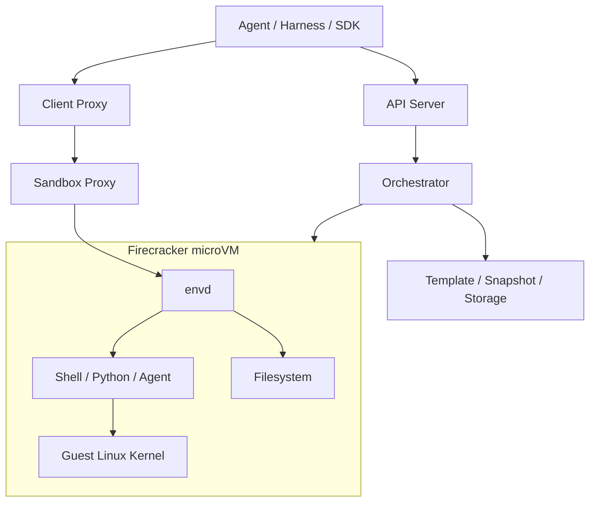
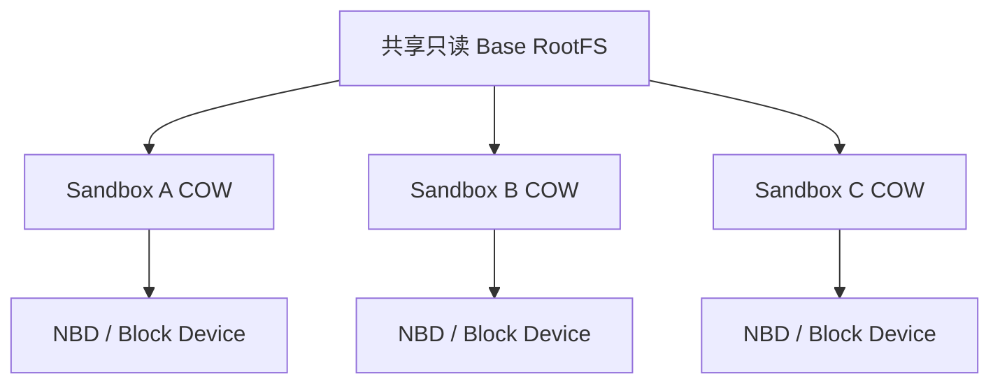
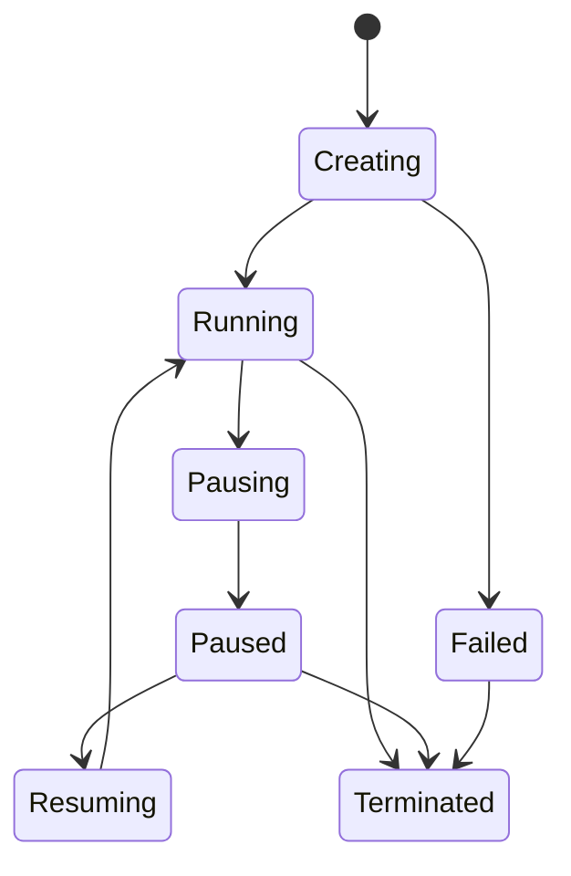

# E2B Sandbox 架构与源码学习笔记

> 2026-11-25 · 面向生产级 Agent Sandbox 基础设施，重点关注自建 E2B、故障恢复、资源隔离和持久化。本文是架构学习提纲，不代表实际部署版本的功能清单。

## 1. 架构总览



控制面负责创建、调度、暂停、恢复和销毁；数据面负责将命令、文件、终端和应用端口请求路由至对应 Sandbox。具体组件与通信方式以部署的源码 commit 为准。

## 2. 十二个核心知识点

| 知识点 | 优先级 | 需要掌握 |
| --- | --- | --- |
| Orchestrator | P0 | VM 管理、资源分配、节点异常 |
| 生命周期 | P0 | Create / Pause / Resume / Kill，幂等与一致性 |
| envd | P0 | Guest Agent、进程执行、文件操作与自愈 |
| Snapshot | P0 | VM 状态、内存、磁盘及一致性 |
| Firecracker | P0 | KVM、microVM、隔离边界 |
| RootFS / NBD / COW | P0 | 共享基础镜像、增量写入、扩容 |
| 网络 | P1 | Proxy、Tap、Netns、NAT、访问控制 |
| Template | P1 | 镜像构建、缓存、预初始化 |
| 调度 | P1 | 节点选择、容量管理、资源回收 |
| UFFD | P1 | userfaultfd、缺页处理、按需加载 |
| 可观测性 | P1 | 日志、指标、链路追踪、健康检查 |
| 计量计费 | P1 | 资源分配与实际使用、生命周期计量、重复事件去重 |

## 3. envd：Guest Agent

envd 运行在 Guest Linux 内，提供远程命令执行、进程管理、标准输入输出流、PTY、文件操作等能力。它不是虚拟化隔离边界，也不是 AI Agent。

典型命令执行路径：

```text
SDK -> Proxy -> envd -> Linux process -> stdout/stderr -> SDK
```

需确认 envd 的启动方式、监听端口、健康检查、鉴权、初始化以及重启后状态恢复机制。不同版本可能存在差异。

### 3.1 故障分类

| 类型 | 典型原因 |
| --- | --- |
| 进程退出 | Guest OOM、panic、信号终止、systemd 启停、VM 终止 |
| 进程存在但不可用 | 死锁、CPU 饥饿、FD/PID 耗尽、磁盘 IO 阻塞 |
| 外部访问不可用 | Proxy、路由、网络 namespace、鉴权或连接异常 |

需要先区分 Guest OS、envd、网络和宿主机故障；SDK 连接失败不等于 envd 已退出。

### 3.2 故障恢复 Runbook

1. 从控制面确认 Sandbox 状态、宿主机状态和生命周期剩余时间。
2. 通过独立路径探测 Guest envd，排除 Proxy 故障。
3. 若 Guest OS 仍运行，检查 systemd 自动重启是否成功。
4. 若存在独立 Guest Console 或 SSH 管理通道，采集日志、判断 OOM/资源耗尽，必要时重启 envd。
5. 若无法恢复 envd，优先保护磁盘和已有快照；确认部署版本支持的恢复能力。
6. 支持磁盘冷启动时，可评估保留磁盘、丢弃内存的恢复流程；不应假定旧版本支持，且需考虑未刷盘数据丢失。
7. 最后重建 Sandbox，从持久化存储和 Agent Checkpoint 恢复业务。

独立 Guest 通道中的诊断命令（服务名、端口和健康路径需按版本确认）：

```bash
pgrep -a envd
systemctl status envd
systemctl cat envd
systemctl show envd -p NRestarts -p Result
journalctl -u envd -n 200 --no-pager
dmesg -T | grep -Ei 'oom|killed process'
ss -lntp
free -m
df -h
df -i
```

必要时执行 `systemctl restart envd`，然后验证健康检查、鉴权、命令执行、文件读写及任务状态。重启可能影响子进程、流式连接和 PTY，先检查 KillMode 与进程管理机制。不要依赖已失效的 envd 自己执行修复命令；宿主机进入网络 namespace 也不等于进入 Firecracker Guest。

### 3.3 恢复分级与保护

| 级别 | 恢复方式 | 影响 |
| --- | --- | --- |
| L1 | Supervisor 重启 envd | 管理进程及相关会话 |
| L2 | 独立通道释放异常资源 | 部分工作负载 |
| L3 | 保留磁盘冷启动 VM（如支持） | 所有运行中进程 |
| L4 | 重建 Sandbox 并恢复持久化数据 | 整个环境 |

自研方案应将管理面与工作负载分别放入受控 cgroup，评估 memory.min、memory.max、pids.max、cpu.weight、OOMScoreAdjust 和独立 watchdog。保护措施必须结合父级资源限制验证，不可将这些参数视为 E2B 默认配置。单纯 Restart=always 不能处理所有死锁或资源耗尽场景。

核心原则：**管理 envd 的能力不能完全依赖 envd 本身；用户任务故障不应轻易导致管理面失效。**

## 4. 快速启动与 Snapshot

普通 VM 冷启动需要启动内核、初始化 OS 和服务。E2B 的快照路径通过预初始化模板、VM 状态恢复、共享镜像和按需加载降低启动成本。

- 内存快照恢复与仅磁盘冷启动有不同语义。前者可能恢复故障状态，后者丢弃运行中进程及内存。
- UFFD（userfaultfd）处理缺失内存页，允许按需读取快照；研究缺页延迟、prefetch、缓存命中、首个请求 RT。
- 关注暂停期间文件系统一致性、快照完成标志、失败回滚、跨节点恢复和版本兼容。
- SDK、控制面 Runtime、模板及 envd 版本需要分别确认；不要依据 SDK 版本单独推断服务器能力。

## 5. RootFS / NBD / COW



重点：读路径缓存、写入增量、磁盘快照、NBD 生命周期、容量扩展、文件系统扩容、IO 放大与宿主机宕机后的数据可恢复性。

待研究：磁盘满后能否在线扩容？扩容需要调整哪些块设备及文件系统层？NBD 服务退出后 VM IO 如何表现？快照上传未完成时如何保证一致性？持久化数据的 RPO/RTO 是多少？

## 6. 生命周期与调度

概念状态机（不是具体版本的枚举）：



关注 Create 请求超时但 VM 已创建、重复 Resume、Pause 中途失败、元数据与实际 VM 状态不一致、节点缩容与异常退出。研究幂等键、状态更新原子性、reconciliation、孤儿 VM 回收和容量预留。

## 7. 网络与安全

研究从 SDK / Client Proxy 到 Sandbox Proxy、Host Netns、Tap 设备、Guest 网卡和 envd 的路径，以及应用端口暴露、DNS、NAT、防火墙和出入站控制。

隔离边界包括 Guest 内部权限和 Host/Guest 虚拟化边界；重点验证跨 Sandbox 隔离、宿主机及内网访问控制、凭据与模板快照泄漏风险。容器和 Firecracker 的恢复入口不同。

## 8. 生产故障与可观测性

| 故障 | 关注点 |
| --- | --- |
| envd OOM / 无响应 | Guest OOM、健康检查、重启策略 |
| Firecracker 被杀 | Host cgroup、退出事件 |
| Orchestrator 退出 | 接管能力、残留资源、状态对账 |
| NBD IO 卡住 | 块设备错误和超时 |
| UFFD 失败 | 缺页延迟、快照读取异常 |
| 路由或状态服务异常 | 元数据一致性、Proxy 可用性 |
| 宿主机宕机 | 快照耐久性、跨节点恢复 |
| 网络资源耗尽 | FD、conntrack、端口、连接数 |

建议指标：创建与恢复延迟 P50/P95/P99、envd 健康率、OOM 次数、VM 密度、内存缺页延迟、磁盘 IO 延迟、快照上传失败率、孤儿 Sandbox 数、任务恢复成功率。

计量设计：记录生命周期事件和资源分配区间，区分实际使用与计费口径，确保事件幂等、异常终止补偿和对账；可与 Agent credits 计量系统对接，但不要将 Sandbox 资源时长直接等同于 credits。

## 9. 源码阅读路线

官方入口：[E2B Runtime](https://github.com/e2b-dev/runtime)、[E2B Infra](https://github.com/e2b-dev/infra)、[E2B 文档](https://e2b.dev/docs)、[Firecracker](https://github.com/firecracker-microvm/firecracker)。

以下是检索关键词和常见模块名称，不保证实际部署版本的目录完全一致。

- [ ] API / Create：定位创建入口、调度和 Orchestrator RPC
- [ ] Orchestrator / Sandbox：VM 创建、销毁、恢复和状态管理
- [ ] Firecracker：进程管理、VM 配置、快照加载
- [ ] envd：启动、Process API、Filesystem API、初始化、健康检查
- [ ] UFFD：缺页服务、内存快照读取、prefetch
- [ ] NBD / RootFS：块设备、COW、缓存、快照
- [ ] Network：Netns、Tap、Proxy、路由、访问控制
- [ ] Template：构建、缓存、版本管理
- [ ] Scheduler：节点选择、容量、异常回收
- [ ] Observability：监控、日志、计量与故障注入

版本确认：

```bash
git rev-parse HEAD
git log -1 --format="%ci %s"
pip show e2b
npm list e2b
```

此外记录服务端构建版本、Guest 内置 envd 版本、模板 ID、Guest kernel 和 Firecracker 版本。

## 10. 两周学习计划

| 日期 | 内容 |
| --- | --- |
| Day 1–2 | 整体架构、Sandbox Create 调用链 |
| Day 3–4 | Orchestrator、Firecracker |
| Day 5 | envd 源码、健康检查与故障恢复 |
| Day 6–7 | RootFS、NBD、COW、磁盘扩容 |
| Day 8–9 | Snapshot、UFFD、冷启动与恢复 |
| Day 10 | 网络和安全隔离 |
| Day 11–12 | 调度、资源隔离和容量管理 |
| Day 13 | 可观测性、计量计费 |
| Day 14 | 在隔离测试环境进行故障注入并总结 |

## 11. 最终目标

1. 如何在单台宿主机高密度运行 Sandbox，并保证尾延迟？
2. 如何在 envd、Orchestrator、存储和宿主机故障下恢复服务？
3. 如何通过持久化存储和 Harness Checkpoint 让 Agent 任务跨 Sandbox 生命周期持续运行？

下一篇：Sandbox Create 全链路源码分析。先锁定实际部署的版本，再从 API -> Orchestrator -> Firecracker -> envd 初始化逐层追踪。
